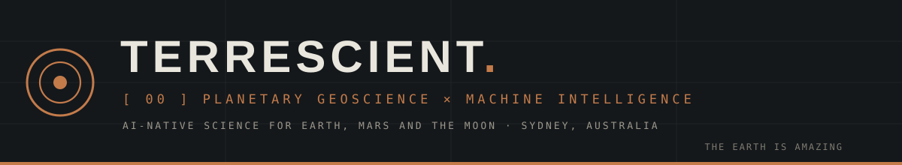
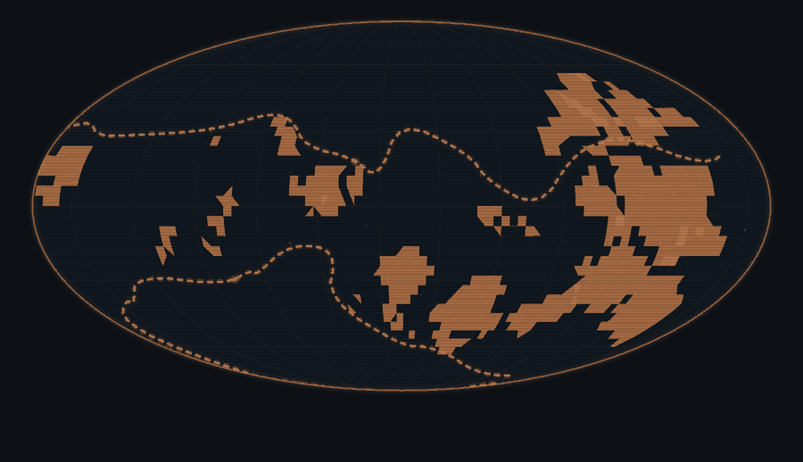

  

  

 

  
  &nbsp;&nbsp;
  

 

> *"Somewhere, something incredible is waiting to be known."* — Carl Sagan

 

## `[ 01 ]` SCIENTIST-LED · AI-NATIVE

Our work is driven by domain knowledge and always grounded in, and validated against, the published literature. Where AI is commonly used simply to make research faster, we take a novel approach: machine intelligence is embedded in our modelling systems as a working component, assembling and testing our physical models and driving our mapping pipelines. This lets us tackle scientific problems that were not previously feasible, at a scale and speed that conventional workflows cannot reach.

**How we use AI**

- **Expertise sets the direction.** Our scientists define the questions, choose the physics and design the experiments. AI accelerates implementation and testing, and every result is checked against the governing equations, established reference models and observations.
- **Validated by the literature.** Our models are built on published, peer-reviewed science and are judged against it. We credit the research our work stands on, and we collaborate closely with the academic groups who produce it.
- **Uncertainty is the product.** Inputs are distributions, outputs are scored ensembles. We never ship one answer when the data support many, and we make the full solution space explorable.
- **Problems that were out of reach.** Efficient methods and AI-assisted development mean hundreds of model runs can cost what one used to, so ensemble questions that once needed a supercomputer become practical on a desktop.
- **Science that AI assistants can use.** Our capabilities are exposed as tools that any AI assistant can call, putting plate reconstruction and mineral mapping in reach of people who are not tectonics or remote-sensing specialists.

 

> *"Any sufficiently advanced technology is indistinguishable from magic."* — Arthur C. Clarke

 

## `[ 02 ]` CURRENT PROJECTS

<table>
<tr>
<td width="50%" valign="top">

### `001` CONTINUUM
**Unified probabilistic plate reconstruction**

A framework for generating full, uncertainty-quantified plate tectonic reconstructions directly from observational data. Where conventional workflows collapse the past into one deterministic model, Continuum treats inputs as distributions and delivers a scored ensemble of statistically viable configurations, with uncertainty propagated from continental position through to plate boundary geometry. Explore the complete solution space, not a single answer. Coupled with Mantlepiece, each reconstruction can be tested by the mantle structure it predicts, linking the Earth's surface history to its deep interior.

</td>
<td width="50%" valign="top">

### `002` MANTLEPIECE
**Agent-assembled geodynamic model**

A global 3D mantle convection model purpose built for ensembles rather than single heroic runs. Built using our propietary Mise Agent-Assembled Model (AAM) architecture, it is constructed by AI agents from tested, interchangeable physical ingredients and graded against frontier geodynamic models and seismic tomography. It runs on a desktop in minutes, so hundreds to thousands of runs with different physical choices are affordable locally where one conventional run would take hundreds of HPC core-hours. Coupled with Continuum, it turns ensembles of plate reconstructions into ensembles of mantle histories, so surface and deep-Earth uncertainty are explored together.

</td>
</tr>
<tr>
<td width="50%" valign="top">

### `003` MISE
**Core framework for Agent-Assembled Models**

Mise is our answer to a simple question: what if a scientific model could be assembled, tested and improved by AI agents working alongside the scientists who direct them? Every model becomes a living codex of physical mechanisms, with interchangeable ingredients that represent them, recipes that assemble them, and an evidence ladder that tests every ingredient before it is trusted. Agents propose, tests decide, and scientists set the questions and the standard of proof.

</td>
<td width="50%" valign="top">

### `004` CKYBORG
**AI satellite mineralogy mapping**

An unsupervised machine-learning pipeline that maps minerals from hyperspectral satellite imagery with neither ground samples nor labelled training data, applicable equally to Earth and planetary investigations. Rapidly process, data-mine and map remote-sensing data products for critical mineral discovery on Earth and mineral resource mapping of Mars and the Moon.

</td>
</tr>
<tr>
<td width="50%" valign="top">

### `005` BLACKBIRD AI
**Earth science as tools for AI assistants**

A hosted service exposing Terrescient's tectonic reconstruction and mineral-mapping capability as typed, agent-callable tools over the Model Context Protocol. Any MCP-capable AI assistant becomes a front end: ask a question in plain language, the AI selects the tools, and the tools return structured results, including ensemble uncertainty from Continuum. The customer's AI supplies the intelligence. We supply the capability.

</td>
<td width="50%" valign="top">

### `006` HUGINN · MUNINN
**Versioned planetary geoscience data platform with automated literature extraction**

Named for Odin's ravens, memory and thought. Muninn consolidates global planetary geoscientific compilations into one canonical, fully provenanced and versioned data platform. Huginn helps our scientists bring published results into that same platform, each record traced to its original source and reviewed before use, so decades of research become live, queryable inputs to the models above.

</td>
</tr>
<tr>
<td width="50%" valign="top">

### `007` GPLATESPRO
**The first commercial GPlates licence**

Developed together with the EarthByte Group at The University of Sydney, GPlatesPro brings GPlates, the open-source market-leading platform for tectonic model development, into professional industry workflows for the first time, with seamless integration into the GIS tools industry already uses. Built on 20+ years of research.

[gplates.org →](https://www.gplates.org) &nbsp; [earthbyte.org →](https://www.earthbyte.org)

</td>
<td width="50%" valign="top">

### `∞` BLACKBIRD
**The foundation underneath**

Every project above is built on Blackbird, Terrescient's proprietary tooling layer for plate model data handling and planetary geoscientific computation, developed directly from current academic research. One shared implementation, tested once, used everywhere.

</td>
</tr>
</table>

<code>Project repositories are private. Access for collaborators, sponsors and reviewers is available on request.</code>

 

> *"Art is I; science is we."* — Claude Bernard

 

## `[ 03 ]` CAPABILITIES

| | |
|:--|:--|
| `001` **Critical mineral discovery** | A data-science framework to predict, map and identify subsurface critical mineral resources for a cleaner energy future. |
| `002` **AI mapping technology** | Rapidly process, data-mine and map remote-sensing data products using our AI mapping framework. |
| `003` **Space exploration** | Explore mineral resource maps of both Mars and the Moon using our AI satellite mapping suite. |
| `004` **Scientific data mining** | Analyse and mine existing scientific datasets to surface hidden value, turning legacy data archives into actionable planetary geoscientific insight. |
| `005` **Digital Earth 4D modelling** | Unprecedented insight through 3 billion years of geological, tectonic and geodynamic history. |
| `006` **Research consultancy** | Bespoke planetary geoscience R&D, machine learning, big data and proof-of-concept progression. |

 

## `[ 04 ]` COLLABORATION

Science does not happen in a vacuum. Actively working with and supporting open-access academic research is key to innovation. A selection of the global institutions and research groups we proudly collaborate with:

| | |
|:--|:--|
| **University of Sydney** | EarthByte / School of Geosciences |
| **ENS Paris** | Laboratoire de Géologie |
| **UT Austin – UTIG** | Geodynamics & Tectonics |
| **Curtin University** | Earth Dynamics Research |
| **University of Helsinki & GTK Finland** | Palaeomagnetics |
| **GFZ Potsdam** | Lithospheric Dynamics |
| **Université Côte d'Azur** | Laboratoire Géoazur |
| **University of Miami** | Department of Marine Geosciences |

We maintain a public fork of [GPlates](https://github.com/Terrescient/GPlates) and contribute back to the open-source tectonics ecosystem our work is built on.

 

## `[ 05 ]` CONTACT

> *"We have two ears and one mouth so that we can listen twice as much as we speak."* — Epictetus

Any questions, thoughts or ideas? We'd love to hear from you. Get in touch to find out how we can work together.

  <code>1000 Ma → 0 Ma · REFERENCE MODEL: MÜLLER ET AL. (2022)</code>

  <a href="https://terrescient.com"><strong>terrescient.com</strong></a>

 

  <code>© 2023–2026 TERRESCIENT PTY LTD · THE EARTH IS AMAZING</code>

