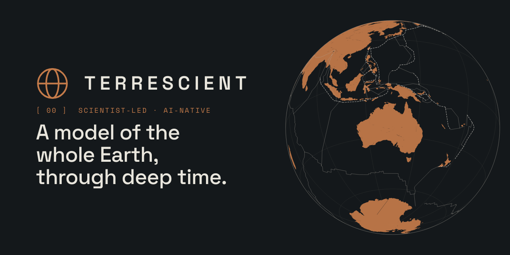

  

  
  &nbsp;&nbsp;
  

 

## `[ 00 ]` SCIENTIST-LED · AI-NATIVE · SYDNEY, AUSTRALIA

Terrescient is a scientist-led, AI-native deep tech company. We build data-driven models of whole Earth evolution with quantified uncertainty, coupled from plate motions to the deep mantle, to power the search for the critical minerals a clean energy future needs.

 

## `[ 01 ]` THE PROBLEM

**Discovery is getting slower and more expensive.** Critical minerals drive the energy transition. The deposits that were once easy to find have been found, and each new discovery takes longer and costs more.

**Deposits form in ancient environments that no longer exist.** Most ore deposits are hundreds of millions to billions of years old. The tectonic settings that made them have since moved, been deformed, buried or destroyed. AI and ML exploration models evaluate the Earth as it is today. We model the Earth system through time.

**Why now.** A coupled model of the whole Earth through time has long been a research programme, not a product. Running one history took months. Running thousands was simply out of reach. Two recent advances have changed that: ensemble computation is now affordable at the scale the problem demands, and AI has advanced from optimising models to reasoning inside them as they run. What was once a career's work is now an experiment.

 

## `[ 02 ]` APPROACH

**Machine intelligence, built into the model.** Most AI in exploration sits outside the model, speeding up a workflow or scoring a map. Ours is part of the architecture. Agents act inside the running Earth model, testing alternative Earth histories against observations, at a scale no team of scientists could. Our scientists set the direction. The model reasons as it runs.

- **Swarms, not monoliths.** Frontier mantle models take days on hundreds of cores chasing one answer. We run swarms of small, fast models that map the solution space single models only sample.
- **Expertise sets the direction.** Our scientists define the questions, choose the physics and design the experiments. Every result is checked against the governing equations, reference models and observations.
- **Autonomy, with limits.** An agent can assemble, run and score an Earth history without a person in the loop. It cannot change the physics, the data or the question.
- **Uncertainty is the product.** Inputs are distributions, outputs are scored ensembles. We never ship one answer when the data support many.
- **Scale changes the question.** A plate reconstruction in seconds, a mantle simulation in minutes, orders of magnitude cheaper per history. The question is no longer which history to run, but which to explore.
- **Every answer can be re-run.** Each result carries the recipe, the data inputs and the model states that produced it, so any ensemble can be reproduced, audited and extended.

 

## `[ 03 ]` THE TERRESCIENT EARTH MODEL

Surface to core, in one loop. Three deterministic physical models run in sequence for every history; agents work between them, never inside them. Agents propose; model tests decide.

| | |
|:--|:--|
| **Mise** · agent coupling layer | Agents assemble each component from a codex of physical ingredients, test every ingredient against the governing equations and published reference runs, and repair what fails. A deterministic queue dispatches the ensemble and grades each history against observations. |
| **Continuum** · plate reconstruction | Every continental position and plate boundary is a variable, scored against the data rather than drawn by an expert. In: palaeomagnetic data, all other data as constraint. Out: a scored ensemble of reconstructions, with boundaries. |
| **Keel** · absolute plate motion | Built on our published model optAPM. Moves reconstructions from the palaeomagnetic frame into the mantle's, and treats the frame as something to test, not assume. Out: the reconstruction anchored to the mantle at every age. |
| **Mantlepiece** · mantle convection | Built for ensembles. Runs the mantle forward under each history and compares what it predicts with what seismology sees, in minutes rather than days. Out: the mantle each history predicts, scored against tomography. |

**Feedback.** A reconstruction is ranked by the mantle it predicts; the plate parameters that fit both the surface record and the mantle beneath seed the next histories.

 

## `[ 04 ]` PRODUCT

**Ask the Earth. Get the answer.** Ask the Earth Model where a continent was, which way it was moving, and when, and it answers with the uncertainty on each: a spread of positions, a spread of motions, a spread of ages, every one scored. Models of the Earth have never taken questions. This one does.

- **Terrescient AI.** Parameterise an experiment, run it, query the ensemble and analyse the result, in plain language. It works with the language model you already use. For data that cannot leave the building, the same assistant runs on your own hardware, and nothing goes back.
- **Data and maps.** Every answer is also data: ranked histories, the maps and grids derived from them and the uncertainty behind each one, in the formats you already use. GPlates, QGIS, a notebook, ParaView. Each result carries the model version and setup, so it can be cited and run again.
- **Tools for any AI assistant.** The same capabilities are exposed as tools any AI assistant can call, and as an API with a Python client for pipelines with no assistant in them.

**A frame for anything with a place and an age.** Any dataset with a position and an age can be put back where it formed, carried through time with the plates, placed against the mantle beneath it, and scored. Critical minerals are the first question we put to it. The same frame holds geothermal and hydrogen, carbon storage, past climate and oceans, the fossil record, even other planets.

 

## `[ 05 ]` SCIENCE AND COLLABORATION

Everything we build stands on published, peer-reviewed research, much of it our own. The Earth Model takes that groundwork and makes it one coupled, testable system. The papers are listed on [terrescient.com](https://terrescient.com/#science).

The collaborations our work is built on:

| | |
|:--|:--|
| **The University of Sydney** | EarthByte, School of Geosciences |
| **California Institute of Technology** | Seismological Laboratory |
| **Université Côte d'Azur** | Géoazur |
| **UT Austin** | Institute for Geophysics |
| **Curtin University** | Earth Dynamics Research Group |
| **ENS Paris** | Laboratoire de Géologie |
| **GFZ Potsdam** | Lithospheric Dynamics |
| **University of Helsinki and GTK Finland** | Palaeomagnetics Laboratory |

We maintain a public fork of [GPlates](https://github.com/Terrescient/GPlates), the open-source plate reconstruction software our toolchain is built on, and are a GPlates Development Partner with the EarthByte Research Group. Our other repositories are private; access for collaborators, sponsors and reviewers is available on request.

 

## `[ 06 ]` PROGRAMMES

| | |
|:--|:--|
| **Partner organisation** | ARC Research Hub for Geodynamic Pathways to Critical Resources (GeoPath), led by The Australian National University, 2026 to 2031. |
| **Startup programmes** | Anthropic · Claude for Startups. AWS Activate. Notion for Startups. |
| **Advisory** | A scientific advisory board of senior researchers in plate tectonics, geodynamics and mineral systems, holding what we build to the standard of the published literature. |

 

## `[ 07 ]` CONTACT

**One address. A person reads it.** Researchers, explorers, investors, reviewers, people who want to work on the whole Earth: write to us and say who you are. We answer.

**hello@terrescient.com** · [terrescient.com](https://terrescient.com) · [LinkedIn](https://www.linkedin.com/company/terrescient) · [Bluesky](https://bsky.app/profile/terrescient.bsky.social) · [X](https://x.com/Terrescient)

 

We at Terrescient acknowledge the Ngunnawal, Ngambri-Kamberri and Cammeraygal peoples as the Traditional Custodians of the lands on which we operate and recognise the incredible depth, contributions and sophistication of First Nations knowledges. We pay our respects to Elders past and present.

  <code>© 2023–2026 TERRESCIENT PTY LTD · THE EARTH IS AMAZING</code>

